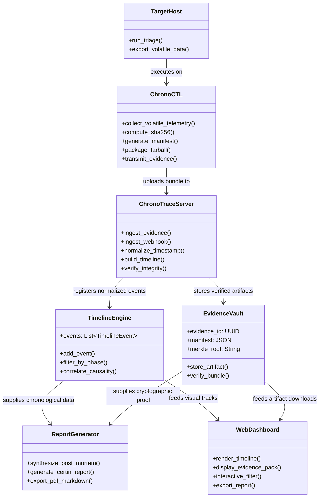
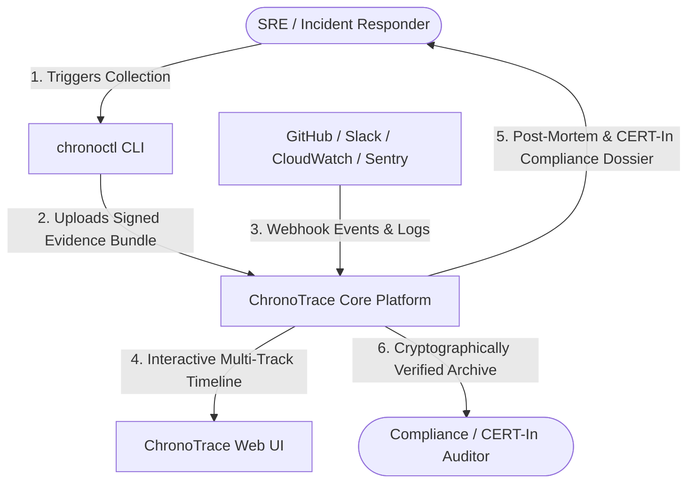
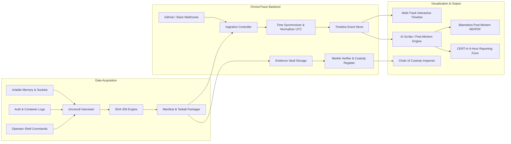

# IDEA.md: ChronoTrace — Incident Timeline & Cryptographic Evidence Vault for Small Teams

**Problem Statement ID:** PS-013  
**Title:** Incident Timeline and Evidence Collection for Small Teams  
**Hackathon:** AIORI-3 Hackathon  
**Team Code:** `A3-PS013-TC027`  
**Team Name:** Team H2RN  
**Lead / Author:** Rachit Ingole (Vishwakarma Institute of Technology)  
**Date:** October 2026  

---

## 1. Abstract & Executive Summary

Small engineering teams and startups operate in high-velocity environments with lean staffing, typically lacking dedicated Security Operations Centers (SOCs) or specialized Digital Forensics and Incident Response (DFIR) personnel. When an operational failure, server intrusion, or cloud security incident occurs, teams plunge into a high-stress "fog of war." 

Engineers prioritize rapid mitigation over evidence preservation—executing ad-hoc terminal commands, restarting crashed containers, or rebooting virtual machines. In doing so, they inadvertently obliterate volatile evidence (RAM, ephemeral network sockets, process tables), violate the foundational **RFC 3227 Order of Volatility**, and scatter diagnostic trails across fragmented terminals, ephemeral logs, and messaging channels. Consequently, building a reliable post-incident timeline becomes an agonizing retrospective puzzle, and mandatory compliance disclosures (such as the **CERT-In 6-hour reporting mandate** or SOC 2 audit standards) become impossible to fulfill accurately.

**ChronoTrace** is an open-source, lightweight incident response orchestration and evidence collection platform engineered specifically for resource-constrained small teams. It bridges the gap between complex enterprise SIEM/SOAR platforms and chaotic manual spreadsheet triage through:
1. **One-Command RFC 3227 Live Collector (`chronoctl`):** A zero-dependency agent/script that snapshots transient volatility-ordered host artifacts (RAM, open sockets, running processes, auth logs, docker state) in under 30 seconds.
2. **Cryptographic Evidence Vault (ISO/IEC 27037):** Computes tamper-evident SHA-256 hashes and builds signed, immutable evidence bundles with strict Chain-of-Custody manifests.
3. **Multi-Track Chronological Timeline Engine:** Automatically normalizes multi-source telemetry (host artifacts, cloud logs, operator shell history, Git commits, and chat alerts) into a single UTC timeline.
4. **AI-Assisted Root Cause & Compliance Reporter:** Correlates timeline anomalies, synthesizes causal graphs, and generates one-click blameless post-mortems alongside pre-filled CERT-In / ISO incident disclosure packages.

---

## 2. Problem Description & Small Team Pain Points

### 2.1 The Small Team Reality
* **No Dedicated Scribe or SOC:** In a team of 3 to 10 engineers, 100% of available engineering bandwidth is dedicated to firefighting. Nobody is assigned to take structured notes, record timestamps, or preserve forensic snapshots.
* **The "Triage vs. Preservation" Dilemma:** Developers frantically restart pods, deploy hotfixes, or purge compromised instances. By the time the service recovers, memory dumps, malicious binaries in `/tmp`, and attacker command histories have been irreversibly purged.
* **Clock & Timezone Drift Chaos:** Diagnostic telemetry arrives from disparate timezones and systems—local laptops (IST/PST), AWS UTC logs, Sentry timestamps, and Docker container clocks. Stitching them together manually wastes hours of engineering time.
* **Lack of Chain of Custody:** Manual screenshots, copy-pasted terminal logs, and unhashed text snippets lack legal validity, failing insurance audits and regulatory investigations.
* **Strict Regulatory Pressure:** Indian regulatory frameworks (CERT-In Direction 20(1)) mandate cyber incident notification within **6 hours** of detection. Small teams face severe compliance penalties if they cannot deliver a verified timeline promptly.

### 2.2 Why Existing Solutions Fail Small Teams

| Tool Category | Examples | Fatal Flaw for Small Teams |
| :--- | :--- | :--- |
| **Enterprise SIEM / SOAR** | Splunk, Palo Alto Cortex XSOAR | Prohibitive licensing ($20k–$100k+/year), massive hardware footprint, requires dedicated full-time operators. |
| **Deep DFIR Triage Tools** | UAC (Unix Collector), CyLR, KAPE, Plaso | Produces gigabytes of raw, unstructured forensic archives that require specialized DFIR knowledge to parse; zero web UI, zero team collaboration. |
| **SRE ChatOps Platforms** | Rootly, Incident.io, FireHydrant | Focus solely on Slack communication choreography and PagerDuty notifications; **zero host-level evidence acquisition, zero memory capture, no cryptographic hashing**. |
| **Ad-Hoc Manual Methods** | Google Docs, Slack bookmarks, Notion | Unstructured, error-prone, completely lacks tamper-evidence, and prone to lost logs after retention expiration. |

---

## 3. Background & Foundational Concepts

### 3.1 The Incident Response Lifecycle (NIST SP 800-61 Rev. 2)
Incident response spans four continuous phases:
1. **Preparation:** Establishing tools, permissions, and collection protocols before a breach occurs.
2. **Detection & Analysis:** Identifying anomalies, validating alerts, and determining the blast radius.
3. **Containment, Eradication & Recovery:** Isolating affected nodes, patching vulnerabilities, and restoring safe operations.
4. **Post-Incident Activity:** Reconstructing the timeline, evaluating lessons learned, and meeting regulatory requirements.

Small teams traditionally fail during the transition between **Detection** and **Containment**, where the rush to contain destroys the forensic evidence needed for post-incident analysis.

### 3.2 The Perishable Evidence Window
Digital artifacts decay at different rates. Without an automated capture mechanism, the most critical artifacts—such as active network sockets, inject-in-memory payloads, unlinked open files, and ephemeral container states—evaporate within minutes of rebooting or container termination.

---

## 4. Literature & RFC Standards Review

ChronoTrace is directly grounded in established internet RFCs, international digital forensic standards, and national statutory directives:

### 4.1 RFC 3227 — Guidelines for Evidence Collection and Archiving
* **Order of Volatility (OOV):** RFC 3227 mandates acquiring data in decreasing order of volatility:
  1. Registers and processor cache (transient CPU state).
  2. Routing tables, ARP cache, process table, kernel statistics, RAM.
  3. Temporary file systems (`/tmp`, swap).
  4. Non-volatile disks and storage.
  5. Remote logging and network telemetry.
* **Preservation of System State:** Minimizes changes to the target system by running standalone, read-only tools rather than installing intrusive dependencies during active response.

### 4.2 ISO/IEC 27037 — Digital Evidence Handling
* Defines protocols for **Identification, Collection, Acquisition, and Preservation** of digital evidence.
* Mandates non-destructive acquisition and verification using cryptographic hashes (SHA-256) at the moment of collection to guarantee integrity.

### 4.3 RFC 5424 — The Syslog Protocol
* Governs structured logging formats, priority values, and standardized **ISO 8601 UTC microsecond timestamps** used by ChronoTrace's log ingestion pipeline.

### 4.4 RFC 8805 & RFC 8877 — Precision Time Synchronization
* Ensures all collected timeline events are synchronized and aligned to Coordinated Universal Time (UTC) to eliminate multi-region and local clock offsets.

### 4.5 Statutory Context: CERT-In Cyber Security Directions (Rule 20(1))
* Requires organizations to report cybersecurity incidents to the Indian Computer Emergency Response Team (CERT-In) within 6 hours of confirmation, necessitating rapid, structured timeline reconstruction.

---

## 5. Proposed Solution: The ChronoTrace Platform

ChronoTrace provides a lightweight, cohesive ecosystem comprising three key architectural components:
1. **`chronoctl` (Lightweight Response & Evidence Collector)**
2. **ChronoTrace Core (Timeline Engine & Evidence Vault)**
3. **ChronoTrace Web Dashboard & Report Synthesizer**

```
                 +-----------------------------------------------+
                 |              TARGET INFRASTRUCTURE            |
                 |  (Linux Host / Docker Pod / Cloud Instance)   |
                 +-----------------------+-----------------------+
                                         |
                       [1] Execute 'chronoctl collect'
                                         v
                 +-----------------------------------------------+
                 |       CHRONOCTL EVIDENCE COLLECTOR AGENT       |
                 |  - Memory Sockets & Active Connections (ss)   |
                 |  - Process Trees & Parent-Child Hierarchy     |
                 |  - Ephemeral /tmp, Auth Logs, Container Dumps |
                 |  - SHA-256 Hash Computation & Manifest Sign   |
                 +-----------------------+-----------------------+
                                         |
               [2] Signed Tarball Upload | (REST API / HTTPS)
                                         v
+--------------------------------------------------------------------------------+
|                             CHRONOTRACE CORE ENGINE                            |
|                                                                                |
|  +-------------------------+  +--------------------------+  +----------------+ |
|  | Multi-Source Ingestion  |  | Time-Sync Normalizer     |  | Tamper-Proof   | |
|  | - Webhooks (GitHub)     |  | - UTC ISO 8601 Converter |  | Evidence Vault | |
|  | - Slack/Discord ChatOps |  | - Drift Detection Engine |  | - SHA-256 Store| |
|  | - Syslog RFC 5424       |  | - Sequence Deduplication |  | - Merkle Tree  | |
|  +-------------------------+  +--------------------------+  +----------------+ |
|                                                                                |
|  +---------------------------------------------------------------------------+ |
|  |                  Unified Multi-Track Incident Timeline                    | |
|  | [Track 1] Alerts & Monitoring (Prometheus, Sentry, AWS CloudWatch)        | |
|  | [Track 2] System & Container Events (chronoctl Volatile Dumps)             | |
|  | [Track 3] Human Actions & Decisions (Shell History, Scribe Notes, Chat)   | |
|  | [Track 4] Code & Deployments (Git Commits, CI/CD Pipeline Runs)            | |
|  +---------------------------------------------------------------------------+ |
+---------------------------------------+----------------------------------------+
                                        |
                 [3] Interactive Timeline & Automated Synthesis
                                        v
+--------------------------------------------------------------------------------+
|                        CHRONOTRACE WEB UI & REPORTING                          |
|                                                                                |
|  * Interactive Visual Timeline with Phase Milestones (Triage -> Containment)   |
|  * Verifiable Chain of Custody Inspector & Artifact Downloader                 |
|  * AI-Assisted Blameless Post-Mortem & Root Cause Analysis (RCA) Generator     |
|  * 1-Click Regulatory Export (CERT-In 6-Hour Incident Notification Format)     |
+--------------------------------------------------------------------------------+
```

### 5.1 Module Specifications

#### Module A: `chronoctl` (RFC 3227 Collector)
* **Zero Dependencies:** Written as a lightweight single Python/Go CLI executable or portable Bash script requiring no external package installations on compromised hosts.
* **Tiered Capture Following Order of Volatility:**
  * *Tier 1 (Volatile Network & State):* Active TCP/UDP sockets (`ss -tulpen`), ARP tables, routing tables.
  * *Tier 2 (Volatile Execution):* Full process tree (`ps auxf`), active environment variables, open unlinked file descriptors (`lsof -nP`).
  * *Tier 3 (Container & Ephemeral Logs):* Docker container inspects, recent container logs, `/var/log/auth.log`, systemd journal snippets (`journalctl -n 500`).
  * *Tier 4 (File Integrity):* MD5 & SHA-256 hashes of modified binaries in `/tmp`, `/dev/shm`, `/bin`.
* **Tamper-Evident Packaging:** Archives captured files into a compressed bundle, creates `manifest.json` with itemized SHA-256 hashes, timestamps, and host metadata, and transmits it via secure HTTPS API to the ChronoTrace Core server.

#### Module B: Time-Sync Normalization & Correlation Engine
* Accepts multi-stream event streams via REST webhooks and log collectors.
* Standardizes every timestamp into microsecond-precision UTC.
* Categorizes events into standard incident phases:
  * `Trigger / Alert`: Initial detection threshold breached.
  * `Exploit / Anomaly`: First malicious request or system anomaly.
  * `Triage`: Human response initiated.
  * `Containment`: Firewall rule applied, pod killed, credential rotated.
  * `Recovery`: Verified system stabilization.

#### Module C: Cryptographic Evidence Vault
* Stores all evidence bundles in an immutable directory structure.
* Maintains a Merkle-tree hash root for the incident; modifying any log or artifact invalidates the incident signature.
* Provides a downloadable, legally sound "Forensic Evidence Pack" containing the chain of custody report, raw files, and verification scripts.

#### Module D: AI Scribe & Report Generator
* Parses the unified timeline and host artifacts using a local or LLM-driven synthesis prompt.
* Automatically drafts:
  1. **Blameless Incident Post-Mortem:** Summary, Root Cause Analysis (RCA), Timeline breakdown, Contributing factors, and Corrective Action Items.
  2. **CERT-In Compliance Export:** Pre-fills the official CERT-In cyber security incident reporting form with affected IP addresses, detection timestamps, incident types, and mitigation actions.

---

## 6. Solution Optimization & Comparative Analysis

### 6.1 Before vs. After Implementation

| Evaluation Dimension | Traditional Small Team Approach | With ChronoTrace |
| :--- | :--- | :--- |
| **Evidence Collection Time** | 45–90 minutes (manual commands, screenshots, copying files) | **< 30 seconds** (single command: `chronoctl collect`) |
| **Volatile Evidence Retention** | > 80% lost (wiped by pod restarts, reboot, or overwrite) | **100% captured** prior to containment action |
| **Order of Volatility** | Violated (disk checked first, RAM ignored) | **RFC 3227 strictly enforced** by automated scripts |
| **Timezone Alignment** | Disjointed (IST, UTC, local machine mix) | **100% unified UTC** with sub-second alignment |
| **Chain of Custody** | Non-existent; unverified text snippets | **Cryptographic SHA-256 hashes & signed manifests** |
| **Post-Mortem Generation** | 3–6 hours of retrospective developer writing | **Instant automated draft** generated from timeline |
| **Compliance Readiness** | Misses 6-hour CERT-In deadline due to manual drafting | **One-click compliant export** ready in minutes |
| **Setup & Maintenance Overhead** | High setup cost or complex agents | **Single Docker Compose deployment** (< 2 minutes) |

---

## 7. System Architecture & Design

### 7.1 Component Architecture (UML Diagram)



---

## 8. Data Flow Diagram (DFD)

### 8.1 DFD Level 0 (Context Diagram)



### 8.2 DFD Level 1 (Internal Pipeline Flow)



---

## 9. Implementation Roadmap & Hackathon Plan

### 9.1 Hackathon Tech Stack
* **Collector CLI (`chronoctl`):** Python 3.10+ / Bash portable script (zero external pip dependencies, uses native POSIX tools: `ss`, `ps`, `lsof`, `sha256sum`, `tar`).
* **Backend API & Processing:** FastAPI (Python) for asynchronous, high-throughput ingestion and lightweight execution; SQLite / DuckDB for zero-setup, embeddable data storage.
* **Frontend Web Dashboard:** Modern React + Vite with Tailwind CSS / Vanilla CSS, Lucide icons, and interactive canvas timeline rendering.
* **Cryptographic Verification:** Native Python `hashlib` (SHA-256) and JSON canonical signing.
* **Report Synthesizer:** Markdown-to-PDF / Jinja2 template engine with optional LLM integration (Ollama / Gemini API / OpenAI API) for post-mortem narrative synthesis.

### 9.2 Hackathon Phased Execution Plan (48-Hour Sprint)

```mermaid
gantt
    title ChronoTrace Hackathon Sprint Milestones
    dateFormat  X
    axisFormat  Hour %d

    section Phase 1: Architecture & CLI
    Research & RFC Mapping         :0, 4h
    chronoctl Collection Script    :2, 8h
    FastAPI Core Ingestion API     :6, 12h

    section Phase 2: Timeline Engine
    Time Normalizer & Webhooks     :10, 16h
    Evidence Vault & Merkle Hashing:14, 20h
    SQLite / Schema Setup          :12, 18h

    section Phase 3: UI Dashboard
    Visual Multi-Track Timeline    :18, 28h
    Evidence Inspector & Details   :22, 30h
    Incident Phase Filtering       :26, 32h

    section Phase 4: Reports & Demo
    AI Scribe / CERT-In Generator  :30, 38h
    Simulated Attack & Test Run    :34, 42h
    Final Pitch Deck & Video Demo  :40, 48h
```



---

## 10. Bibliography & RFC References

1. **RFC 3227** — Brezinski, D., & Killalea, T. (2002). *Guidelines for Evidence Collection and Archiving*. Internet Engineering Task Force (IETF). [https://www.rfc-editor.org/rfc/rfc3227](https://www.rfc-editor.org/rfc/rfc3227)
2. **ISO/IEC 27037:2012** — International Organization for Standardization. *Information technology — Security techniques — Guidelines for identification, collection, acquisition and preservation of digital evidence*.
3. **NIST SP 800-61 Rev. 2** — Cichonski, P., Millar, T., Grance, T., & Scarfone, K. (2012). *Computer Security Incident Handling Guide*. National Institute of Standards and Technology. [https://doi.org/10.6028/NIST.SP.800-61r2](https://doi.org/10.6028/NIST.SP.800-61r2)
4. **RFC 5424** — Gerhards, R. (2009). *The Syslog Protocol*. Internet Engineering Task Force (IETF). [https://www.rfc-editor.org/rfc/rfc5424](https://www.rfc-editor.org/rfc/rfc5424)
5. **RFC 8877** — Mirsky, G., Halpern, J., & Minaburo, A. (2020). *Guidelines for Defining Additional Precision Time Protocol (PTP) Extensions*. IETF.
6. **CERT-In Cyber Security Directions** — Ministry of Electronics and Information Technology (MeitY), Government of India. *Directions under sub-section (6) of section 70B of the Information Technology Act, 2000 relating to information security practices* (April 2022).
7. **MITRE ATT&CK Framework** — MITRE Corporation. *Enterprise Matrix for Incident Analysis & Telemetry Mapping*. [https://attack.mitre.org/](https://attack.mitre.org/)
